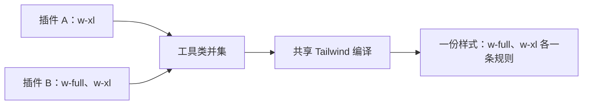

<!-- 该文档已固定，禁止修改 -->

# dsh-taiwind

[![npm version][npm-version-src]][npm-version-href]
[![npm downloads][npm-downloads-src]][npm-downloads-href]
[![bundle][bundle-src]][bundle-href]
[![CI][ci-src]][ci-href]
[![Tailwind CSS][tailwind-src]][tailwind-href]
[![DSH][dsh-src]][dsh-href]
[![Node.js][node-src]][node-href]
[![License][license-src]][license-href]

🎨 **dsh-taiwind** 仅适用于插件作者，为 DeepSeek Harness 插件提供一份共享的 Tailwind CSS：工具类在宿主侧统一收集、编译、去重，不必每个插件各带一份重复样式。

> 基于 Tailwind CSS **4.3.3**，要求 DSH ≥ `0.2.1-alpha.1`、Node.js ≥ `22.18.0`。

## Why？

DSH 插件各自发布成独立的 npm 包样式的交付方式也跟着各自为政：按约定，插件挂一个 `<style data-plugin="...">` 标签，内容要么是手写 CSS。手写 CSS 意味着每个作者都要自己发明类名、主题和响应式写法，彼此不通用；而整份 Tailwind 输出塞进包里的话，由于任意两个插件都会用到同一批 `flex`、`gap-2`、`w-full`，同一个页面就会把相同的规则编译并加载 N 次。

`dsh-taiwind` 将这段编译放进宿主进程：每次客户端插件图变化，它从各插件的构建文件里收集完整类名，连同包内的 CSS-first 定义（`@theme`、`@utility` 等）一起交给同一个 Tailwind 编译器，输出一份样式注入页面。插件因此仍可独立发布、独立构建，不需要 monorepo、不需要统一构建工具，也不用各自处理去重：



而去重针对共享编译产生的工具类，不是把多个 CSS 文件拼起来删重复字符串，也不会删除其他插件已挂载的样式。

## ✨ 特性

- **CSS-first**：直接读取 `main.css`，支持 `@theme`、`@utility`、`@apply`。
- **官方编译器**统一生成样式，不加载 Preflight，也不改动宿主。
- **首帧内联，磁盘缓存兜底**：由客户端接管同一个标签；冷启动先使用 `~/.dsh/taiwind/styles.css`。
- **免刷新**：插件和 `main.css` 变动后自动重新编译，ETag 命中时返回 304；停用后完整清理。

## 🚀 快速开始

### 1. 安装

```sh
pnpm add dsh-taiwind@latest
```

在业务插件的 `cordis.patch.yml` 里插入它（连同自身行）：

```yaml
- insert:
    - id: my-plugin
      name: dsh-my-plugin
    - id: dsh-taiwind
      name: dsh-taiwind
```

用户启用业务插件时，`dsh-taiwind` 将随行一起启用。

- 它没有界面和工具，唯一产物是共享样式接口 `plugins/taiwind.css` 和页面上的 `<style data-plugin="dsh-taiwind">`。
- 扫描范围是当前客户端图里所有插件的构建产物，插件图变化会自动触发重新编译。

### 2. 声明样式入口

在插件包的 `package.json` 里显式声明未编译的 CSS 入口（相对包根，必须位于包内）：

```json
{
  "dsh": {
    "taiwind": "src/main.css"
  }
}
```

`main.css` 保留未编译的 CSS-first 写法：

```css
@import "tailwindcss";

@theme {
  --color-notes-accent: #7c3aed;
  --container-notes-panel: 28rem;
}

@utility notes-compact {
  padding: 3px;
}
```

🚀 客户端直接使用 taiwind 类名，例如 `bg-notes-accent w-notes-panel notes-compact` 即可。

### 3. 发布时携带样式文件

在 `package.json` 中添加 `files` 字段，发布时需要携带入口 CSS 及它引用的相对 CSS：

```json
{
  "files": [
    "src/main.css",
    "tailwind.config.js"
  ]
}
```

## ⚙️ 配置文件（可选）

可在包根目录放一份 `tailwind.config.js`，或用 CSS 的 `@config` 显式引用：

```js
/** @type {import("tailwindcss").Config} */
export default {
  darkMode: 'class',
  theme: {
    extend: {
      colors: { 'notes-accent': 'var(--notes-accent)' },
      width: { 'notes-panel': '28rem' },
    },
  },
}
```

CSS 入口存在时**不会自动加载根目录 JS 配置**，需要时在 CSS 中显式写 `@config "./tailwind.config.js";`（路径相对该 CSS 文件）。

配置文件按包自身的 `type` 走原生 ESM / CJS 加载：改配置本身即刻生效；`.cjs` 配置连同 `require` 的依赖一起热重载，ESM 配置 import 的模块需要重启进程生效。

## 📚 配置与限制

| 项目 | 说明 |
| --- | --- |
| 发布 | 原始入口及其相对导入必须打包进 npm。 |
| 不支持 | TS 配置、npm CSS 导入、路径别名、远程 CSS、`@plugin`、把文件路径写进 `@source`、自定义扫描目录、跨包 CSS。 |
| 合并与冲突 | 按插件 ID 和入口路径排序后交给 Tailwind 4 合并；CSS 定义优先于 JS，同名时后者覆盖；定义不一致时只发 warn（包含双方包名，不重复刷屏）。 |
| 全局共享 | 所有插件共用主题和全局选项；非法配置和不兼容的 JS 选项仍会阻止更新。 |
| 自定义 CSS与动态值 | CSS 原样输出，但不限定作用域、不去重、不改资源 URL；动态值请使用 CSS 变量或内联样式。 |
| 成本 | 需要安装 Tailwind 与 Oxide 扫描器，约占 8–10mb 磁盘，并产生宿主 CPU 开销。 |
| 首屏时序 | 首帧使用本轮产物或磁盘缓存；两者都没有时才显示官方 boot 覆盖层（`HARNESS` 和环形进度，文案固定为 `Loading appearance…`，不做 i18n，4 秒后淡出）。 |
| 失败降级 | 编译失败时继续下发上一版，只记一条 warn；客户端取样式失败时保留现状，并每 2 秒重试。 |

## 🛠️ 开发与贡献

```sh
pnpm install --frozen-lockfile
pnpm run lint
pnpm run typecheck
pnpm run test -- --run
pnpm run build
```

## 📜️ 许可证

- [MIT](<LICENSE.md>) © dsh-tauri-desk，保留上游模板授权。

<!-- Badges -->

[npm-version-src]: https://img.shields.io/npm/v/dsh-taiwind?style=flat&colorA=080f12&colorB=1fa669
[npm-version-href]: https://npmjs.com/package/dsh-taiwind
[npm-downloads-src]: https://img.shields.io/npm/dm/dsh-taiwind?style=flat&colorA=080f12&colorB=1fa669
[npm-downloads-href]: https://npmjs.com/package/dsh-taiwind
[bundle-src]: https://img.shields.io/bundlephobia/minzip/dsh-taiwind?style=flat&colorA=080f12&colorB=1fa669&label=minzip
[bundle-href]: https://bundlephobia.com/result?p=dsh-taiwind
[ci-src]: https://img.shields.io/github/actions/workflow/status/hairyf/dsh-taiwind/ci.yml?branch=main&style=flat&colorA=080f12&colorB=1fa669&label=CI
[ci-href]: https://github.com/hairyf/dsh-taiwind/actions/workflows/ci.yml
[tailwind-src]: https://img.shields.io/badge/Tailwind_CSS-4.3.3-1fa669?style=flat&colorA=080f12
[tailwind-href]: https://tailwindcss.com/docs
[dsh-src]: https://img.shields.io/badge/DSH-%3E%3D0.2.1--alpha.1-1fa669?style=flat&colorA=080f12
[dsh-href]: https://github.com/hairyf/dsh-taiwind/blob/main/package.json
[node-src]: https://img.shields.io/badge/Node.js-%3E%3D22.18.0-1fa669?style=flat&colorA=080f12
[node-href]: https://nodejs.org/
[license-src]: https://img.shields.io/github/license/hairyf/dsh-taiwind.svg?style=flat&colorA=080f12&colorB=1fa669
[license-href]: https://github.com/hairyf/dsh-taiwind/blob/main/LICENSE.md
