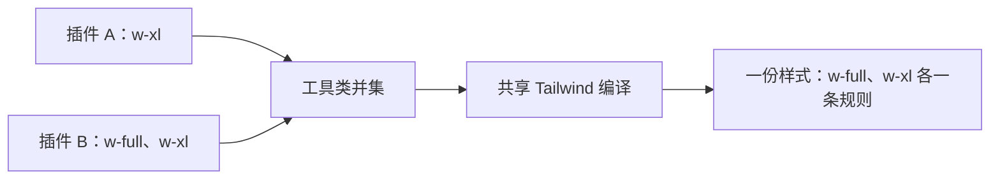

# dsh-taiwind

[![npm version][npm-version-src]][npm-version-href]
[![npm downloads][npm-downloads-src]][npm-downloads-href]
[![bundle][bundle-src]][bundle-href]
[![CI][ci-src]][ci-href]
[![Tailwind CSS][tailwind-src]][tailwind-href]
[![DSH][dsh-src]][dsh-href]
[![Node.js][node-src]][node-href]
[![License][license-src]][license-href]

🎨 **dsh-taiwind** 仅适用于插件作者，为 DeepSeek Harness 插件提供一份共享的 Tailwind CSS：工具类在宿主侧统一收集、编译、去重，不必每个插件各带一份重复样式。

> 基于 Tailwind CSS **4.3.3**，要求 DSH ≥ `0.2.1-alpha.1`、Node.js ≥ `22.18.0`。

## Why？

DSH 插件各自发布成独立的 npm 包样式的交付方式也跟着各自为政：按约定，插件挂一个 `<style data-plugin="...">` 标签，内容要么是手写 CSS。手写 CSS 意味着每个作者都要自己发明类名、主题和响应式写法，彼此不通用；而整份 Tailwind 输出塞进包里的话，由于任意两个插件都会用到同一批 `flex`、`gap-2`、`w-full`，同一个页面就会把相同的规则编译并加载 N 次。

`dsh-taiwind` 将这段编译放进宿主进程：每次客户端插件图变化，它从各插件的构建文件里收集完整类名，连同包内的 CSS-first 定义（`@theme`、`@utility` 等）一起交给同一个 Tailwind 编译器，输出一份样式注入页面。插件因此仍可独立发布、独立构建，不需要 monorepo、不需要统一构建工具，也不用各自处理去重：



而去重针对共享编译产生的工具类，不是把多个 CSS 文件拼起来删重复字符串，也不会删除其他插件已挂载的样式。

## ✨ 特性

- **CSS-first**：保留未编译的 `main.css`，支持 `@theme`、`@utility`、`@custom-variant`、`@apply`、`@source inline(...)`。
- **按需扫描**：从 `clientModules.graph()` 取当前客户端包，`clientPath(id)` 定位构建产物，不依赖插件源码。
- **官方编译器**：Tailwind 扫描器提取候选类，统一编译；不加载 Preflight，不重置宿主界面。
- **单一 style**：首屏注入 `<head>`，客户端接管同一个 `<style data-plugin="dsh-taiwind" data-plugin-css="utilities">`。
- **自动收缩**：删除类名、分包或卸载插件后，下次成功编译即收缩；无磁盘缓存。
- **失败保留**：运行期编译失败返回 503，已打开页面保留上一份有效样式，修复后自动恢复。
- **条件请求**：带 ETag 的 CSS 接口，命中返回 304；插件图变化立即刷新，另每两秒检查产物与配置。
- **完整清理**：停用移除路由、监听、定时器与客户端样式，并取消进行中的请求。

## 🚀 快速开始

### 1. 安装

```sh
pnpm add dsh-taiwind
```

在业务插件的 `cordis.patch.yml` 里插入它（连同自身行）：

```yaml
- insert:
  - id: my-plugin
    name: dsh-my-plugin
  - id: dsh-taiwind
    name: dsh-taiwind
```

用户启用业务插件时，`dsh-taiwind` 将随行一起启用，而客户端半也必须有一行启用中的 Loader 条目才会被 `dsh-client-modules` 加载。

- 它没有界面、没有工具，唯一产物是共享样式接口 `plugins/dsh-taiwind.css` 和页面上的一个 `<style data-plugin="dsh-taiwind">`。
- 宿主半要求 `clientModules`、`webServer`、`connection` 三件服务齐备。
- 扫描范围是当前客户端图里所有插件的构建产物，插件图变化会自动触发重新编译。

### 2. 在插件包里写样式

在插件包中保留未编译的 `main.css`，不需要 `tailwind.config.js`，也不用把路径传给本插件：

```css
@import "tailwindcss";

@theme {
  --color-notes-accent: #7c3aed;
  --container-notes-panel: 28rem;
}

@utility notes-compact {
  padding: 3px;
}
```

客户端直接使用 `bg-notes-accent w-notes-panel notes-compact` 即可。

入口发现顺序：

1. 包根目录的 `main.css`
2. 客户端入口同目录的 `client/main.css`
3. 找到多个会明确报错，不任意选择

### 3. 发布时携带样式文件

在 `package.json` 中添加 `files` 字段，发布时需要携带 `main.css`：

```json
{
  "files": [
    "src/main.css",
    "tailwind.config.js"
  ]
}
```

## ⚙️ 配置文件（可选）

可在包根目录放一份 `tailwind.config.js`，或用 CSS 的 `@config` 显式引用：

```ts
/** @type {import("tailwindcss").Config} */
export default {
  darkMode: 'class',
  theme: {
    extend: {
      colors: { 'notes-accent': 'var(--notes-accent)' },
      width: { 'notes-panel': '28rem' },
    },
  },
}
```

CSS 入口存在时**不会自动加载根目录 JS 配置**，需要时在 CSS 中显式写 `@config "./tailwind.config.js";`（路径相对该 CSS 文件）。

## 📚 配置与限制

| 项目 | 说明 |
| --- | --- |
| 发布 | 原始 CSS 入口及其相对导入必须进 npm 包；只发 `dist` 时一并复制，不要用展开后的构建 CSS 代替 |
| 不支持 | npm CSS 包导入、路径别名、远程 CSS、`@plugin`、文件路径形式的 `@source`、自定义 `source(...)` 扫描目录、跨包 CSS 导入 |
| 冲突检测 | 自定义 token、同名 `@utility` / `@custom-variant` 定义不一致会报错并指包名；非完整 CSS 语义等价判断 |
| 主题合并 | 遵循 Tailwind 4：同 token 的 CSS 定义优先；所有插件共享全局主题，不按插件隔离 |
| 自定义 CSS | 一起输出，但不自动限定作用域、去重或改写资源 URL；请用插件前缀选择器和可直接访问的资源地址 |
| 动态值 | 适合 CSS 变量或内联样式，不要拼接不完整类名 |
| 共享编译器成本 | 需安装 Tailwind、Oxide 原生扫描器等宿主依赖；有磁盘占用与宿主 CPU 开销 |
| 共享不是隔离 | 共用主题与全局选项，冲突可能阻止整份样式更新；不适合要求完全独立 Tailwind 配置的插件 |

## 🛠️ 开发与贡献

```sh
pnpm install --frozen-lockfile
pnpm run lint
pnpm run typecheck
pnpm run test -- --run
pnpm run build
```

## 📜️ 许可证

- [MIT](<LICENSE.md>) © dsh-tauri-desk，保留上游模板授权。

<!-- Badges -->

[npm-version-src]: https://img.shields.io/npm/v/dsh-taiwind?style=flat&colorA=080f12&colorB=1fa669
[npm-version-href]: https://npmjs.com/package/dsh-taiwind
[npm-downloads-src]: https://img.shields.io/npm/dm/dsh-taiwind?style=flat&colorA=080f12&colorB=1fa669
[npm-downloads-href]: https://npmjs.com/package/dsh-taiwind
[bundle-src]: https://img.shields.io/bundlephobia/minzip/dsh-taiwind?style=flat&colorA=080f12&colorB=1fa669&label=minzip
[bundle-href]: https://bundlephobia.com/result?p=dsh-taiwind
[ci-src]: https://img.shields.io/github/actions/workflow/status/hairyf/dsh-taiwind/ci.yml?branch=main&style=flat&colorA=080f12&colorB=1fa669&label=CI
[ci-href]: https://github.com/hairyf/dsh-taiwind/actions/workflows/ci.yml
[tailwind-src]: https://img.shields.io/badge/Tailwind_CSS-4.3.3-1fa669?style=flat&colorA=080f12
[tailwind-href]: https://tailwindcss.com/docs
[dsh-src]: https://img.shields.io/badge/DSH-%3E%3D0.2.1--alpha.1-1fa669?style=flat&colorA=080f12
[dsh-href]: https://github.com/hairyf/dsh-taiwind/blob/main/package.json
[node-src]: https://img.shields.io/badge/Node.js-%3E%3D22.18.0-1fa669?style=flat&colorA=080f12
[node-href]: https://nodejs.org/
[license-src]: https://img.shields.io/github/license/hairyf/dsh-taiwind.svg?style=flat&colorA=080f12&colorB=1fa669
[license-href]: https://github.com/hairyf/dsh-taiwind/blob/main/LICENSE.md
