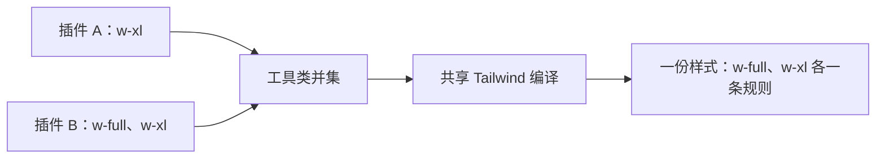
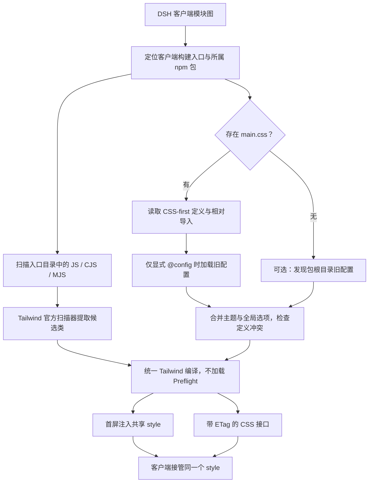
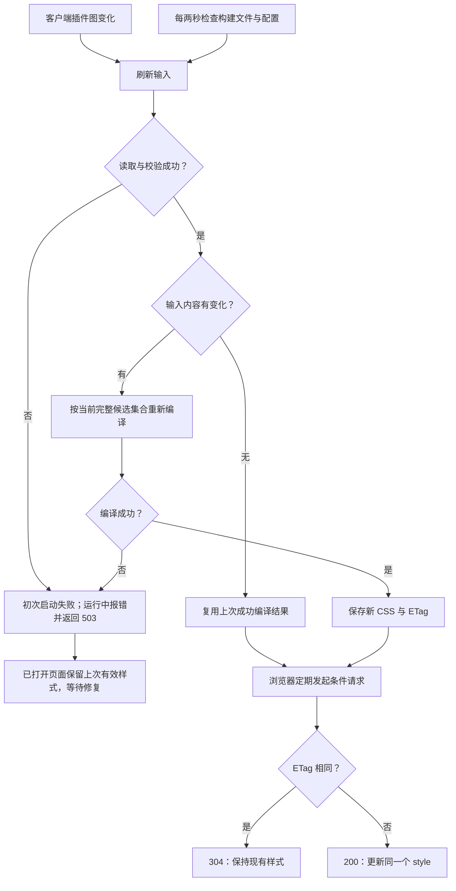

# dsh-taiwindcss

[![npm version][npm-version-src]][npm-version-href]
[![npm downloads][npm-downloads-src]][npm-downloads-href]
[![bundle][bundle-src]][bundle-href]
[![CI][ci-src]][ci-href]
[![Tailwind CSS][tailwind-src]][tailwind-href]
[![DSH][dsh-src]][dsh-href]
[![Node.js][node-src]][node-href]
[![License][license-src]][license-href]

为 DeepSeek Harness 插件提供一份共享的 Tailwind CSS：插件各自发布 npm 包，工具类统一收集、编译和去重，不必再各带一份重复的 Tailwind 样式。

基于 Tailwind CSS 4.3.3，要求 DSH `>=0.2.1-alpha.1`、Node.js `>=22.18.0`。本仓库提供源码和构建产物；尚未发布 npm，不能把 `npm install dsh-taiwindcss` 当作已经可用的安装方式。

## Why？为什么需要它

DSH 插件是独立的 npm 包，却运行在同一个页面。如果每个插件分别编译并挂载 Tailwind，常用的宽度、间距、布局规则就会重复输出；若只靠宿主预先生成，又无法覆盖第三方插件后来新增的类。

`dsh-taiwindcss` 把编译放到 DSH 宿主侧：从当前客户端插件的构建文件中收集完整类名，再用同一套 Tailwind 编译器生成共享样式。插件仍可独立开发和发布，不需要加入同一个 monorepo，也不要求使用同一种构建工具。



这里的去重针对共享编译产生的工具类，不是把多个 CSS 文件拼接后删掉重复字符串，也不会自动删除其他插件已经挂载的样式。

## 有什么好处？与 CSS-in-JS 相比

两者都能让样式与组件放在一起，区别在于复用的单位。常见 CSS-in-JS 会为组件样式生成类名；Tailwind 直接复用 `flex`、`gap-2`、`w-full` 这样的工具类，本插件再把复用范围扩展到不同 npm 包。

| 对比点 | 常见运行时 CSS-in-JS | Tailwind + dsh-taiwindcss |
| --- | --- | --- |
| 跨插件复用 | 各包生成的组件样式不一定能跨包去重，取决于实现与共享运行时 | 相同工具类进入同一次编译，在共享产物中只生成一次 |
| 浏览器工作 | 可能在组件渲染时计算、序列化并插入样式 | 浏览器使用已编译的 CSS；不运行 Tailwind 编译器，也不按组件渲染生成规则 |
| 状态与主题 | 通过 props、主题对象或库 API 表达 | 用 `hover:`、`md:`、`dark:` 等变体组合样式，CSS-first token 集中参与编译 |
| 独立包接入 | 需要各包约定库版本、主题和样式挂载方式 | 客户端保留完整类名，按需附带原始 `main.css`；共享编译与挂载交给本插件 |

这些优势主要针对运行时 CSS-in-JS。构建期提取 CSS 的方案也能减少浏览器运行时工作，部分原子化方案同样能复用规则；不能据此断言 Tailwind 在所有项目里都更小或更快。这里的重点是 **DSH 独立插件之间共享工具类产物**，不是替代所有样式方案。动态数值仍适合使用 CSS 变量或内联样式，不应拼接不完整的类名。

## 实现原理

宿主只处理当前客户端模块图中的包，把构建文件里的候选类与包内 CSS-first 定义分开收集，再交给同一个编译器。



共享样式既会增长，也会在删除类名或卸载插件后收缩。更新失败时不清空已打开页面的有效样式，修复后再替换。



## 工作方式

- 宿主从 `clientModules.graph()` 获取当前客户端包，通过 `clientPath(id)` 定位真实构建产物，不依赖插件源码或统一的构建工具。
- 扫描客户端入口所在目录及其子目录中的 `.js`、`.cjs`、`.mjs`；跳过 `node_modules`、`archive` 和符号链接。不扫描源码映射，也不追踪目录外的分包。
- 通过 Tailwind 官方扫描器抽取候选类，统一编译；不加载 Preflight，避免重置宿主界面。
- 初次编译完成后，把样式注入首页 `<head>`。客户端接管同一个 `<style data-plugin="dsh-taiwindcss" data-plugin-css="utilities">`，不额外创建第二份。
- 插件图变化时立即刷新；另外每两秒检查一次产物和配置。内容未变时复用成功编译结果，浏览器使用 ETag 条件请求。没有磁盘缓存。
- 删除类名、分包或卸载插件后，下次成功编译会收缩样式。首次编译失败会使插件启动失败；运行期间编译失败则记录错误、接口返回 503，已经打开的页面保留上一份有效样式，修复后自动恢复。
- 停用时移除路由、监听、定时器和客户端样式，并取消进行中的请求。

这不是 DOM 运行时扫描器。`"w-" + size` 无法保证被识别，应该使用完整类名映射，例如 `{ compact: "w-32", wide: "w-xl" }`。扫描单位是构建文件，因此同目录宿主代码、无关字符串或已注册但未实际使用的类也可能进入候选集合；不保证只包含当前可见 DOM 的类。

## CSS-first：推荐用法

在插件包中保留未编译的 `main.css`，不需要 `tailwind.config.js`，也不需要把路径传给本插件：

```css
@import "tailwindcss";

@theme {
  --color-notes-accent: #7c3aed;
  --container-notes-panel: 28rem;
}

@utility notes-compact {
  padding: 3px;
}
```

客户端使用 `bg-notes-accent w-notes-panel notes-compact` 即可。入口按以下顺序发现：包根目录的 `main.css` → 客户端入口同目录的 `main.css` → 包内其他位置唯一的 `main.css`，例如 `src/client/main.css`。最后一步找到多个入口会明确报错，不任意选择。递归扫描跳过 `node_modules`、`archive`、`.git` 和符号链接。

只扫描当前客户端图中插件所属的 npm 包，`package.json` 名称必须与客户端 ID 一致。发布时必须把原始 CSS 入口及其相对导入文件放进 npm 包；若只发布 `dist`，可把原始 `main.css` 及其依赖一起复制进 `dist`，不要用已经展开成工具类的构建 CSS 代替它。

CSS 入口存在时，**不会自动加载根目录的 JS 配置**。确实需要兼容旧配置时，在 CSS 中显式添加 `@config "./tailwind.config.js";`；路径相对于写下指令的 CSS 文件。没有 CSS 入口时才自动发现根目录的旧配置；两者都没有时，仍可使用默认 Tailwind 工具类。

支持 `@theme`（包括 `inline`、`static` 等 Tailwind 选项）、`@utility`、`@custom-variant`、`@apply`、相对 `.css` 的 `@import` / `@reference`，以及 `@source inline(...)`。相对导入的 layer、媒体条件由 Tailwind 处理。`@import "tailwindcss"` 及标准 theme/utilities 子入口统一由共享编译器提供，不重复加载；Preflight 始终不加载。`prefix(...)`、`important`、`source(none)` 支持，其中 prefix 和 important 必须在所有插件间一致。

不支持 npm CSS 包导入、路径别名、远程 CSS、`@plugin`、文件路径形式的 `@source`、自定义 `source(...)` 扫描目录和跨包 CSS 导入；遇到这些用法会报错。候选类默认来自客户端构建文件，额外完整类名可用 `@source inline(...)` 声明。普通自定义 CSS 会一起输出，但不会自动限定作用域、去重或改写其中的资源 URL，应使用插件前缀选择器和可直接访问的资源地址。

不同插件的 CSS 自定义 token、同名 `@utility` / `@custom-variant` 定义不一致会报错并指出包名；这不是完整的 CSS 语义等价判断，也不保证检测 CSS 与旧 JS 配置之间的所有冲突。CSS 与 JS 的同名主题合并遵循 Tailwind 4：同一 token 的 CSS 定义优先，不是任意同名工具类都由 CSS 覆盖；例如 `--container-panel` 不会覆盖旧配置 `theme.extend.width.panel` 生成的 `w-panel`。所有插件仍共享全局主题，并非按插件隔离。

CSS 入口、相对导入文件或类名修改后，下次检查会重新编译；删除类名、入口或插件后会收缩样式。导入循环、缺失文件、语法错误均沿用失败保留与修复后恢复机制。

## 可选的旧配置兼容

在没有 CSS 入口的插件包根目录放一份 `tailwind.config.js`、`.cjs`、`.mjs`、`.ts`、`.cts` 或 `.mts`，或者通过 CSS 的 `@config` 显式引用。兼容 `taiwind.config.*` 拼写，但自动发现时同一个包只能有一份配置。不向上误用工作区配置。

```ts
export default {
  darkMode: 'class',
  theme: {
    extend: {
      colors: {
        'notes-accent': 'var(--notes-accent)',
      },
      width: {
        'notes-panel': '28rem',
      },
    },
  },
}
```

使用 `bg-notes-accent w-notes-panel` 即可。发布插件时，需要把这份配置和它依赖的辅助模块放进 npm 包的 `files` 清单；只发布 `dist` 会使根配置丢失。配置在宿主进程中执行，和普通插件代码具有相同信任要求，不是沙箱。

第一版支持的配置范围：

- `theme.extend`：静态、可表示为 JSON 的对象、数组和值；不支持函数或直接替换 `theme.colors` 等默认主题段。
- `darkMode`、`prefix`、`important`：全局选项，所有显式设置它们的插件必须一致。未指定 `darkMode` 时默认使用 `class`。前缀遵循 Tailwind v4，例如 `prefix: 'tw'` 对应 `tw:w-full`，不是 v3 的 `tw-w-full`。
- 旧配置不支持 `content`、`safelist`、`plugins`、`presets` 或任意额外配置项；遇到它们明确报错，不静默忽略。扫描范围由共享编译器决定，与各包构建时的 Tailwind `content` 无关。

各包的 `theme.extend` 合并成一个全局主题：同路径同值共享，不同值报错并指出相关包；同主题段下，嵌套路径、连字符路径及 `DEFAULT` 展开后同名的 token 也检查冲突。不同主题段之间仍遵循 Tailwind 本身的工具类优先级，不承诺检测所有可能的同名工具类语义冲突。**独立配置文件不等于样式隔离**：配置作用于所有参与编译的插件，建议给自定义 token 加插件前缀；全局前缀、重要性和暗色策略也不是按插件单独生效。

根配置修改会重新加载，TypeScript 辅助模块修改也已覆盖刷新测试。原生 CJS/JSON 辅助模块受 Node.js 模块缓存影响，修改后需要重启宿主；本插件不会清理其他插件共享的模块缓存。

## 取舍与限制

- **共享编译器也有成本**：安装时需要 Tailwind、Oxide 原生扫描器等宿主依赖，增加磁盘占用；首次编译及后续输入变化也会消耗宿主 CPU。编译器不进入浏览器，但不等于整个插件安装包更小；只有少量样式的单个插件未必值得引入。这里不提供未经测量的体积或性能收益数字。
- **共享不是隔离**：插件共用主题和全局选项，定义冲突可能阻止整份样式更新；动态拼接类名也无法可靠扫描。适合采用共同约定、使用完整工具类的插件，不适合要求完全独立 Tailwind 配置的插件。

## 和已有 CSS 共存

本插件只对自己生成的样式去重，不删除宿主或其他插件已经挂载的 CSS。如果插件还在打包并加载自己的 Tailwind 样式，页面仍会存在重复规则；迁移时应停止该插件的独立 Tailwind CSS 挂载，保留确实需要的非 Tailwind 自定义样式。不同来源、不同版本 Tailwind 之间的主题及层叠优先级也不会自动统一。

服务地址为 `plugins/dsh-taiwindcss.css`，只允许经过 DSH Connection 来源和身份校验的 GET/HEAD 请求。它不是独立 CSS 构建服务，不接受用户提交配置或路径。

## 本地开发与验证

```sh
pnpm install --frozen-lockfile
pnpm run lint
pnpm run typecheck
pnpm run test -- --run
pnpm run build
```

`pnpm run dev` 监听构建。此仓库的构建和测试不会自动安装到正在运行的 DSH profile；接入真实界面仍需通过 DSH 插件管理安装该包并启用，且宿主必须提供 `clientModules`、`webServer`、`connection` 服务。客户端没有独立页面，也不能用单独的 Vite 服务替代 DSH。

测试覆盖真实 Tailwind 编译的去重、CSS-first 入口发现与优先级、相对导入和重载、CSS 指令、显式 `@config`、定义冲突、旧配置合并、分包和删除收缩；宿主/客户端测试使用受控服务和 DOM 替身覆盖条件请求、失败保留、恢复、首次编译竞态及清理，不代表已在用户运行中的 DSH 界面验收。

## 发布

普通分支 CI 成功不等于 npm 已发布。模板的 Release 工作流仅由 `v*` 标签触发，需要另行配置 npm Trusted Publisher；本次实现不创建版本标签、不发布 npm。

## License

[MIT](<LICENSE.md>) © dsh-tauri-desk，保留上游模板授权。

<!-- Badges -->

[npm-version-src]: https://img.shields.io/npm/v/dsh-taiwindcss?style=flat&colorA=080f12&colorB=1fa669
[npm-version-href]: https://npmjs.com/package/dsh-taiwindcss
[npm-downloads-src]: https://img.shields.io/npm/dm/dsh-taiwindcss?style=flat&colorA=080f12&colorB=1fa669
[npm-downloads-href]: https://npmjs.com/package/dsh-taiwindcss
[bundle-src]: https://img.shields.io/bundlephobia/minzip/dsh-taiwindcss?style=flat&colorA=080f12&colorB=1fa669&label=minzip
[bundle-href]: https://bundlephobia.com/result?p=dsh-taiwindcss
[ci-src]: https://img.shields.io/github/actions/workflow/status/hairyf/dsh-taiwindcss/ci.yml?branch=main&style=flat&colorA=080f12&colorB=1fa669&label=CI
[ci-href]: https://github.com/hairyf/dsh-taiwindcss/actions/workflows/ci.yml
[tailwind-src]: https://img.shields.io/badge/Tailwind_CSS-4.3.3-1fa669?style=flat&colorA=080f12
[tailwind-href]: https://tailwindcss.com/docs
[dsh-src]: https://img.shields.io/badge/DSH-%3E%3D0.2.1--alpha.1-1fa669?style=flat&colorA=080f12
[dsh-href]: https://github.com/hairyf/dsh-taiwindcss/blob/main/package.json
[node-src]: https://img.shields.io/badge/Node.js-%3E%3D22.18.0-1fa669?style=flat&colorA=080f12
[node-href]: https://nodejs.org/
[license-src]: https://img.shields.io/github/license/hairyf/dsh-taiwindcss.svg?style=flat&colorA=080f12&colorB=1fa669
[license-href]: https://github.com/hairyf/dsh-taiwindcss/blob/main/LICENSE.md
